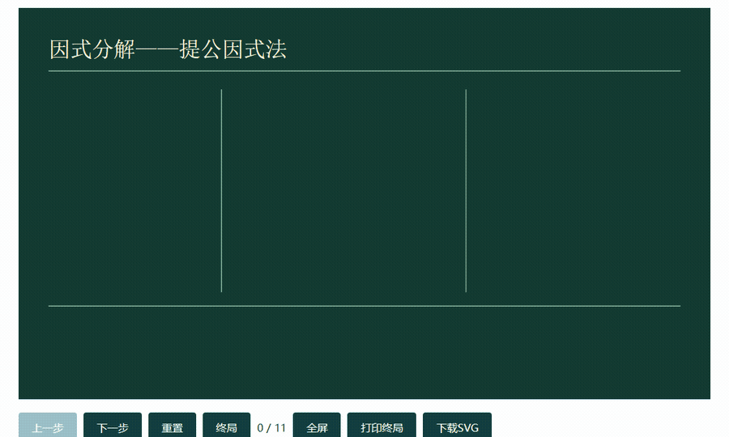

# Factorization in Ten Minutes

[中文](README.md) · [Live site](https://yuchen486.github.io/FactorizationTeaching/) · [Reuse guide](REUSE.md#english) · [Agent index](llms.txt)

A complete teaching-resource package for a mathematics-teaching methods course. Based on section 8.4 of the current Huaibei reference edition of the Shanghai Science and Technology Press Grade 7 mathematics textbook, it presents a 600-second micro-teaching lesson on introductory factorization by extracting a common factor.

## Start here

- Visit the [GitHub Pages site](https://yuchen486.github.io/FactorizationTeaching/)
- For offline use, open [docs/index.html](docs/index.html) directly; no build step or backend is required
- Review the [source and verification notes](references/sources.md)

|Resource|Editable source|Reading or presentation entry|
|---|---|---|
|Teaching script|[Markdown](lesson-plans/L01-script.md)|[Printable reader](docs/script.html)|
|Lesson plan|[Plan](lesson-plans/L01-lesson-plan.md)|[Printable reader](docs/lesson.html)|
|Board design|[SVG](board-design/L01-board.svg)|[Step-by-step board](docs/board.html)|
|Slides|[Storyboard](slides/L01-storyboard.md), [copy and illustration plan](slides/L01-api-v3.json)|[HTML slides](docs/slides.html), [PPTX](outputs/L01-课件.pptx)|
|Exercises|[Questions and answers](exercises/L01-exercises.md)|E01–E05 in-class, E06 after-class|

The lesson has 15 slides. Each identifies its teaching phase, and the final 15 seconds introduce the optional E06 assignment. The PowerPoint and web player use the same slide images. [Production and verification record](assets/records/baseline-v3.md)

## Watch the board build up

Advance through 11 states. The interface and teaching materials are in Chinese. [Interactive board](https://yuchen486.github.io/FactorizationTeaching/board.html) · [Final-state screenshot](assets/showcase/board-final.png)

## Use it in your classroom

- Rehearse with the [teaching script](lesson-plans/L01-script.md) and the web player. The player supports keyboard navigation, fullscreen mode and PowerPoint download.
- To adapt the lesson, use the [reuse guide](REUSE.md#english) to update exercises, timing, slide copy, notes and board states together.
- When using an agent, share this repository and point it to [llms.txt](llms.txt) and [AGENTS.md](AGENTS.md). Useful search terms include grade 7 algebra, factoring polynomials, greatest common factor, microteaching and progressive board design.

## Repository layout

- `docs/`: static site deployed to GitHub Pages
- `lesson-plans/`, `board-design/`, `slides/`, and `exercises/`: teaching materials and editable sources
- `assets/` and `outputs/`: slide images and accepted deliverables
- `scripts/`: content-build and verification scripts; `work/` is ignored local scratch space

Student responses are scripted examples, and the actual lesson duration should be confirmed through rehearsal. The textbook is referenced only for teaching scope and structure; this repository does not include a full textbook.

## Attribution and license

Original author: [HNNUYUXUAN / Yuxuan Miao](https://github.com/HNNUYUXUAN). The public repository is maintained by [yuchen486](https://github.com/yuchen486).

This repository is released under [CC BY-NC-SA 4.0](LICENSE). Reuse and adaptations require attribution, are limited to non-commercial use, and must be shared under the same terms.
