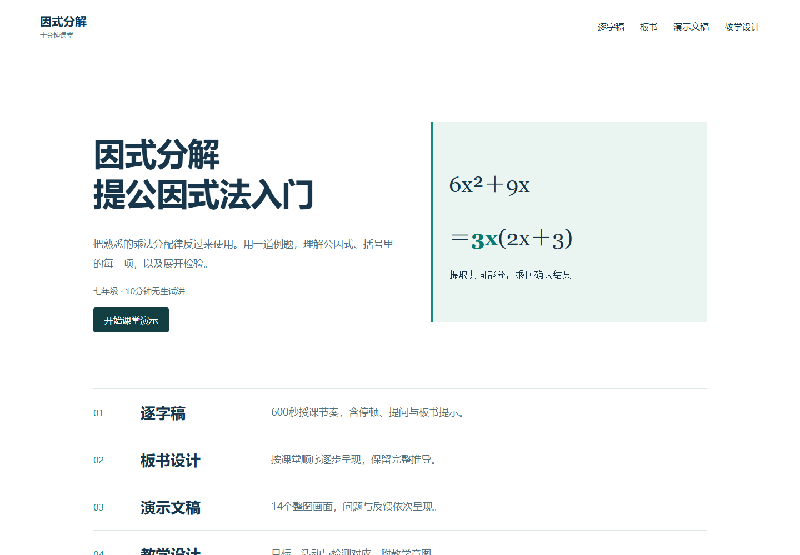
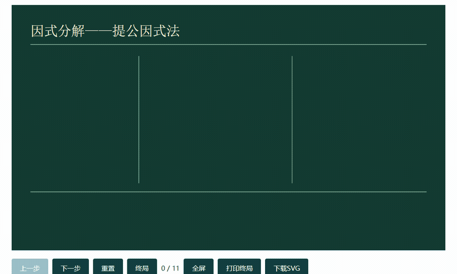

# 因式分解 · 十分钟课堂

[English](README.en.md) · [在线体验](https://yuchen486.github.io/FactorizationTeaching/) · [复用指南](REUSE.md) · [Agent 资料索引](llms.txt)

面向师范生教学方法课程的完整教学资源包。项目参照淮北市现行沪科版七年级下册 8.4，围绕“因式分解——提公因式法入门”设计 600 秒无生试讲，并提供可离线使用的逐字稿、教案、板书、课件与练习。

## 使用入口

- [GitHub Pages 在线站点](https://yuchen486.github.io/FactorizationTeaching/)
- 本地直接打开 [docs/index.html](docs/index.html)，无需构建或后端服务
- [教学来源与核验状态](references/sources.md)

|资料|可编辑源文件|阅读或展示入口|
|---|---|---|
|逐字稿|[Markdown](lesson-plans/L01-script.md)|[阅读打印](docs/script.html)|
|教学设计|[教案](lesson-plans/L01-lesson-plan.md)|[阅读打印](docs/lesson.html)|
|板书|[SVG](board-design/L01-board.svg)|[逐步板书](docs/board.html)|
|课件|[逐页分镜](slides/L01-storyboard.md)、[文案与插图设计](slides/L01-api-v3.json)|[HTML 课件](docs/slides.html)、[PPTX](outputs/L01-课件.pptx)|
|练习|[题目与答案](exercises/L01-exercises.md)|E01—E05 课堂练习，E06 课后练习|

课件共 15 页。每页左上角标明教学环节，最后 15 秒用于 E06 选做作业。PPTX 和 HTML 使用同一组整页图片。[成图与验收记录](assets/records/baseline-v3.md)

## 看板书怎样形成

从空板书开始依次推进 11 步。可直接操练，也可查看静态终局。[在线逐步板书](https://yuchen486.github.io/FactorizationTeaching/board.html) · [终局截图](assets/showcase/board-final.png)

## 用在自己的课堂

- 试讲时按[逐字稿](lesson-plans/L01-script.md)对照每屏节奏。网页支持方向键翻页、全屏和 PPTX 下载。
- 改编时先查[复用指南](REUSE.md)，从题目、时间轴和可见文案入手，保持课件、讲者备注、板书和练习同步。
- 用 Agent 找资料时提供仓库地址，并让它读取 [llms.txt](llms.txt) 与 [AGENTS.md](AGENTS.md)。项目主题包括初中数学、整式、提公因式法、无生试讲和分步板书。

## 仓库结构

- `docs/`：GitHub Pages 直接发布的静态站点
- `lesson-plans/`、`board-design/`、`slides/`、`exercises/`：教学材料与可编辑源文件
- `assets/`、`outputs/`：课件图片和已验收成品
- `scripts/`：内容构建与核验脚本；`work/` 为 Git 忽略的本地临时目录

学生回答均为预设，实际授课时长请结合排练调整。教材仅用于教学范围与结构参照；本站不附教材整册文件。

## 署名与许可

原作者：[HNNUYUXUAN / Yuxuan Miao](https://github.com/HNNUYUXUAN)。公开仓库由 [yuchen486](https://github.com/yuchen486) 维护。

本仓库以 [CC BY-NC-SA 4.0](LICENSE) 许可发布：使用或改编时须署名、限非商业用途，并以相同方式共享。
